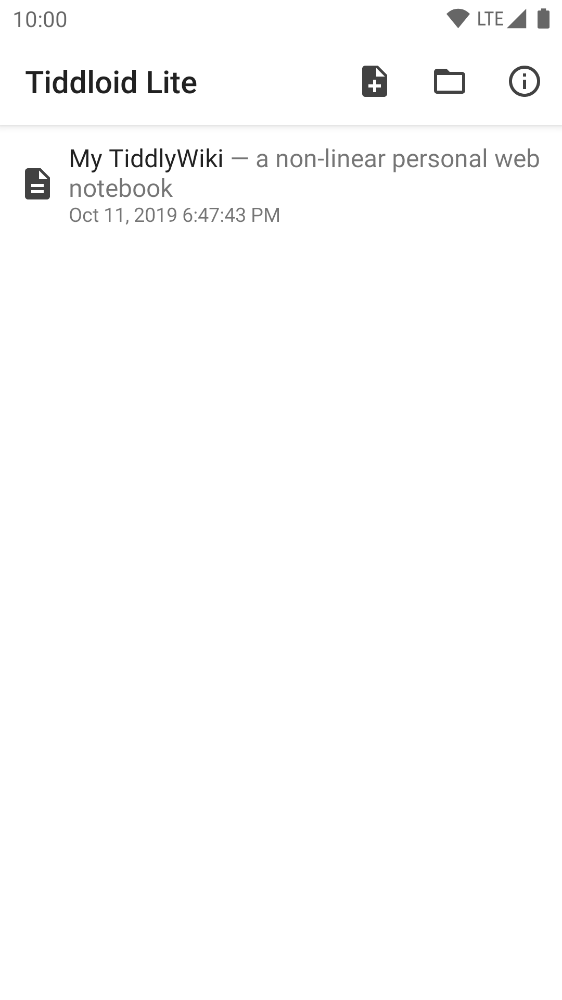
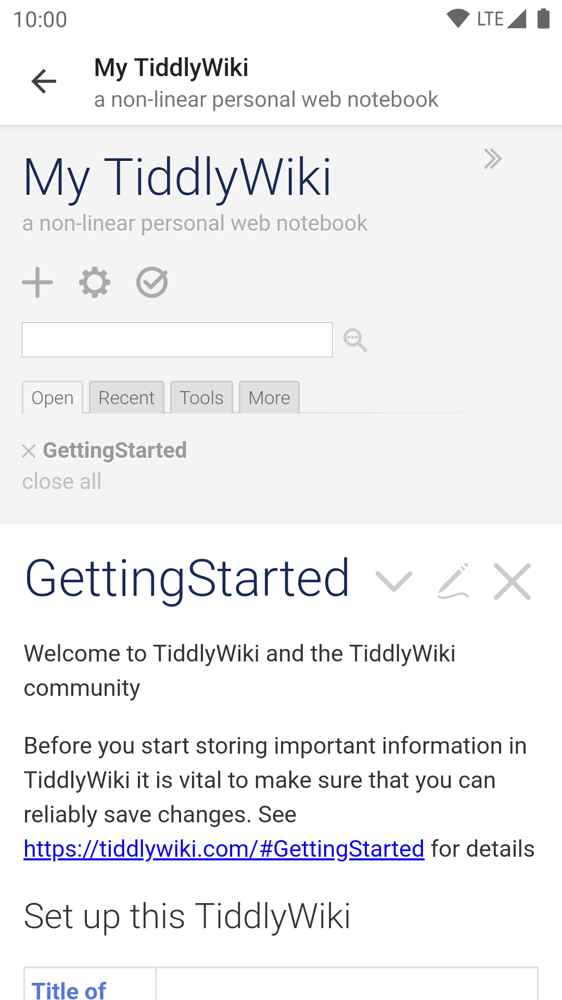

# Tiddloid Lite

Tiddloid Lite, a lightweight version of [Tiddloid](https://github.com/donmor/Tiddloid), is an app to work with locally stored TiddlyWikis. Once have some ideas, you can immediately write them down and save it in a tiddler, and sync the Wiki to your other devices so that you can access these ideas anywhere.

&emsp;

See https://tiddlywiki.com/ for more details of TiddlyWiki.

### Discontinuance Announcement

There will be no feature updates since version 1.2.0, because all unique features have been merged into version 2.0.0 of [Tiddloid](https://github.com/donmor/Tiddloid). However, it'll still be updates for bug fixes for Tiddloid Lite, and it will remain LITE.

### Features

* Create new Wikis with latest template
* Import existing Wikis from file providers, supporting local and cloud.
* Saving TiddlyWikis to the source file by clicking the Save button
* Creating shortcuts to existing wiki on desktop

### Frequently Asked Questions

* How to apply UI tweaks?

  Install the plugin provided along with the apk and:

    * Apply theme color: Check `Control Panel/Appearance/Tiddloid Tweaks/Apply theme color to system bars`.
    * Hide toolbar: Check `Control Panel/Appearance/Tiddloid Tweaks/Hide toolbar on loading complete`.

* I encountered a Javascript error followed by a white screen in newly created files.

    * Check your Android version. TiddlyWiki 5.1.23 has critical bugs on Android 5.1 and below (WebView 39). A solution is to get a pre-release version of TiddlyWiki, which have had this bug fixed or, a previous version without this bug.

* Why there's a Tiddloid Lite? What's the difference between this and Tiddloid?

    In the past 1.x days, Tiddloid use legacy `file://` ways to handle files, causing the lack of access to cloud medias. Later I made another branch that implements Android's SAF (i.e. Storage Access Framework), and finally it became a lightweight version. Now since Tiddloid 2.0 has been refactored to use SAF, this project has been discontinued except for bug fixes.

    Here's the difference between different versions:

  | Feature                                   | Tiddloid 1.x                                             | Tiddloid 2.0 and above                                                                | [Tiddloid Lite](https://github.com/donmor/TiddloidLite)        |
    |-------------------------------------------|----------------------------------------------------------|---------------------------------------------------------------------------------------|----------------------------------------------------------------|
  | File API                                  | Java File API                                            | Android Storage Access Framework and also Java File API                               | Android Storage Access Framework                               |
  | Backup system                             | Yes                                                      | Yes                                                                                   | No                                                             |
  | Search-and-Fork system                    | Yes                                                      | No (Instead it receives shared URLs from browsers and show options to save the page)  | No                                                             |
  | Downloader                                | Yes                                                      | No                                                                                    | No                                                             |
  | Direct access to files in the same folder | Yes                                                      | Partial (Legacy, or TiddlyWiki folders by caching all files)                          | No                                                             |
  | Cloud Service                             | No                                                       | Yes (via SAF)                                                                         | Yes (via SAF)                                                  |
  | Template                                  | Download on first startup, manually updated              | Download on creating new wiki, and cached in case it is unable to access the Internet | Download on creating new wiki                                  |
  | Compatibility                             | Supports legacy Android versions and most of TiddlyWikis | Supports latest Android versions best and supports most of TiddlyWikis                | Supports latest Android versions best and supports most of TW5 |
  | Recommended Android version               | Android 4.4 ~ 9.0                                        | Android 5.0 and above, best for 8.0                                                   | Android 5.0 and above, best for 8.0                            |

### License

This app is released under GPL v2 license,
1. Commercial use
2. Modification
3. Distribution
4. Private use

is permitted UNDER THESE CONDITIONS:
1. Provide this license and copyright notice
2. State changes
3. Disclose source under
4. Same license.

License files provided along with the source code.

### Localization

The localization of this app is currently provided by Google Translation. Pull requests are welcomed if you have better localization.

### About us

Thank you for trying our productions. I'd really appreciate it if you kindly support us via the buttons below, and take more effect to improve our productions.

&ensp;&ensp;&ensp;&ensp;

Fell free to visit [my homepage](https://donmor.top/).
