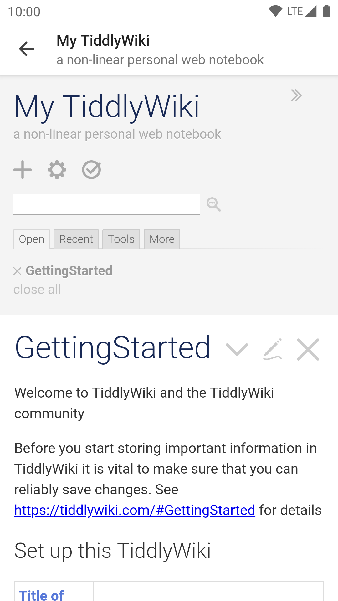

# Tiddloid Lite

Tiddloid Lite是一款适用于本地存储的TiddlyWiki的应用程序，是[Tiddloid](https://gitee.com/donmor/Tiddloid)的轻量版。一旦有了一些想法，您可以立即将它们写下来以供随时查阅。

&emsp;

有关TiddlyWiki的更多详细信息，请参阅https://tiddlywiki.com/。

### 开发中止声明

从1.2.0版开始，Tiddloid Lite将不再收到功能性更新，因为其所有独特功能已经整合到[Tiddloid](https://gitee.com/donmor/Tiddloid)的2.0.0版本。然而，Bug修复类更新将继续发布，并使其保持简洁易用。

### 主要功能

* 使用最新模板创建新的TiddlyWiki
* 导入存储在可写来源的现有Wiki，支持本地或云存储
* 点击保存按钮保存更改到源文件
* 在桌面创建现有Wiki的快捷方式

### FAQ

* 如何调整界面？

    导入随apk提供的插件并： 

    * 应用主题色：选中`Control Panel/Appearance/Tiddloid Tweaks/Apply theme color to system bars`。
    * 隐藏标题栏：选中`Control Panel/Appearance/Tiddloid Tweaks/Hide toolbar on loading complete`。

* 新建的Wiki出现Javascript错误弹框并白屏。

    * 检查Android系统版本。TiddlyWiki 5.1.23版本在Android 5.1及以下(WebView 39)存在严重bug。一个解决方案是使用已经修复了此bug的pre-release版本，或者未出现此bug的旧版本。

* 为什么单独有一个Tiddloid Lite？它和Tiddloid有什么区别？

    在之前的1.x版本中，Tiddloid使用旧的`file://`协议打开文件，此方式不支持访问云存储。之后我制作了基于SAF（即Storage Access Framework）的Tiddloid Lite，最终成为一个轻量版。现在Tiddloid已经换用SAF，Tiddloid Lite的开发已中止。

    以下是不同版本之间的差异：

  | 功能           | Tiddloid 1.x                       | Tiddloid 2.0 及以上                   | [Tiddloid Lite](https://gitee.com/donmor/TiddloidLite) |
      |--------------|------------------------------------|------------------------------------|--------------------------------------------------------|
  | 文件API        | Java文件API                          | Android SAF以及 Java文件API            | Android SAF                                            |
  | 备份系统         | 有                                  | 有                                  | 无                                                      |
  | 搜索-克隆系统      | 有                                  | 无（改为接收从浏览器分享的TiddlyWiki站点URL并保存）   | 无                                                      |
  | 下载服务         | 有                                  | 无                                  | 无                                                      |
  | 直接访问同目录下的文件  | 支持                                 | 部分支持（旧版模式，文件夹模式通过缓存所有文件）           | 不支持                                                    |
  | 云存储          | 不支持                                | 支持（通过SAF）                          | 支持（通过SAF）                                              |
  | 模板           | 首次使用时下载，可手动更新                      | 创建新文件时下载，并缓存以备无网络时使用               | 创建新文件时下载                                               |
  | 兼容性          | 适配旧Android版本，支持TiddlyWiKi5及Classic | 适配新Android版本，支持TiddlyWiKi5及Classic | 适配新Android版本，支持TiddlyWiKi5                             |
  | 推荐的Android版本 | Android 4.4 ~ 9.0                  | Android 5.0 及以上，8.0最佳              | Android 5.0 及以上，8.0最佳                                  |

### 许可

本应用程序遵循GPLv2许可发布，许可证文件随源代码提供。

### 多语言

此应用的翻译目前由Google翻译提供。如果您有更好的版本，欢迎在GitHub/Gitee上发起Pull Request。

### 关于作者

感谢您尝试我们的作品。如果您愿意支持，本人将不胜感激，并不遗余力地加以改进。

&ensp;&ensp;&ensp;&ensp;

欢迎访问[我的主页](https://donmor.top/)。
